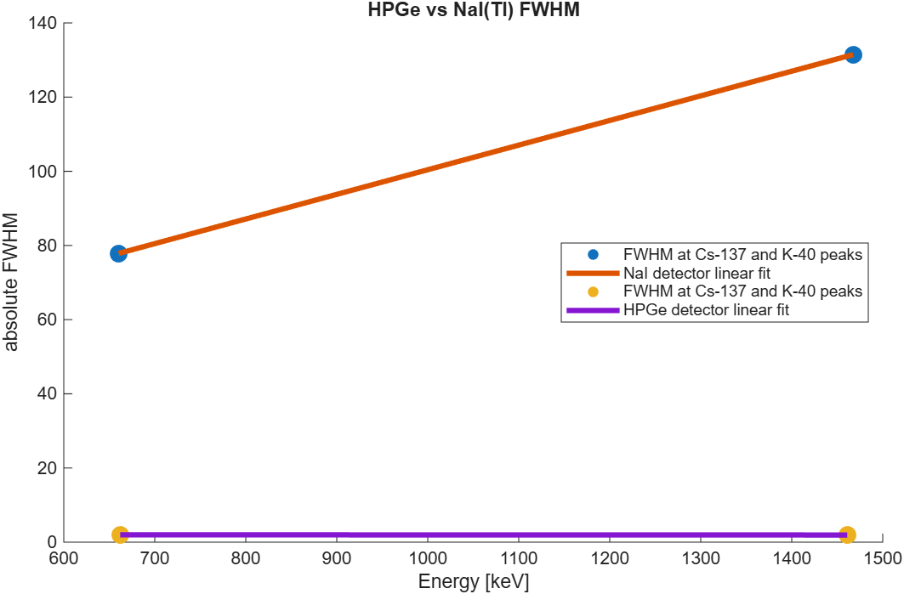
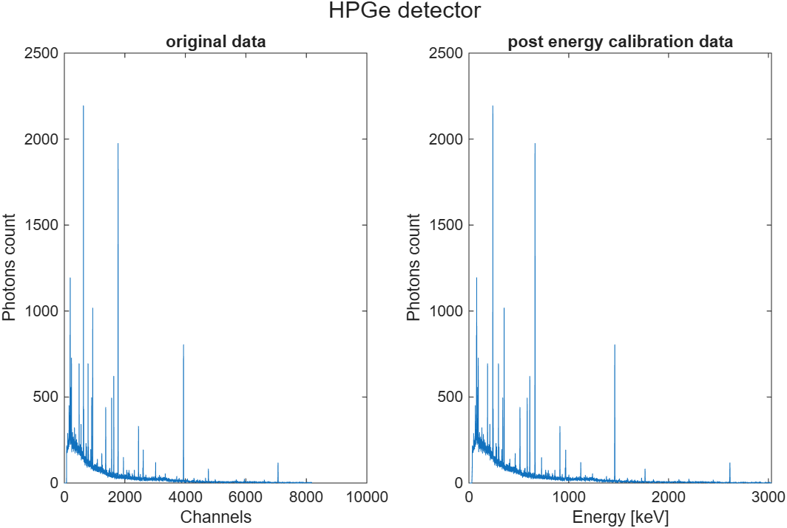
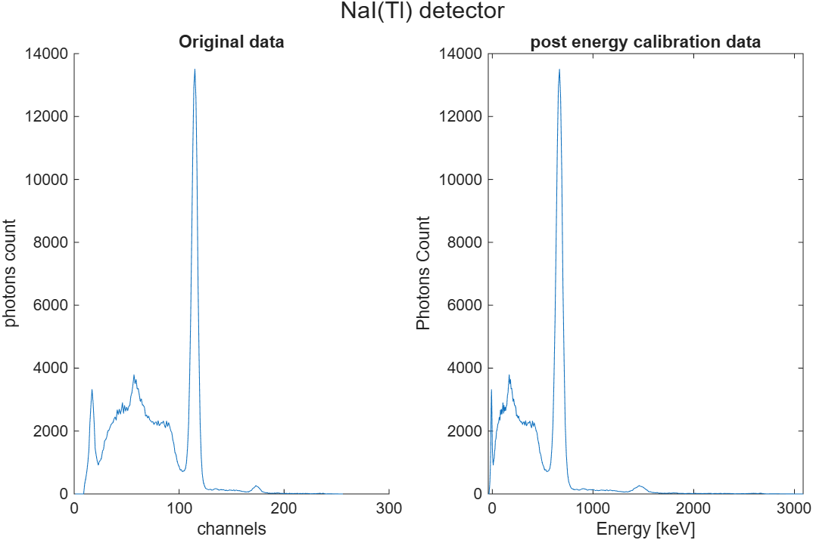
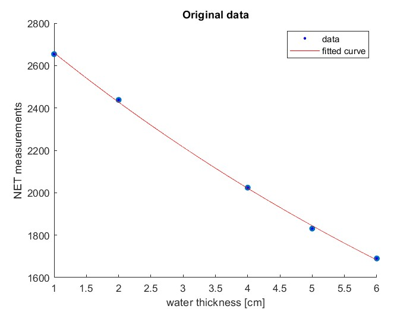

# Gamma-ray spectroscopy: HPGe vs. NaI(Tl) detectors

Nuclear engineering lab, Aristotle University of Thessaloniki, ECE, 2024–25. I took real gamma-ray
spectra with a high-purity germanium (HPGe) detector and a sodium iodide scintillator (NaI(Tl)),
calibrated both energy scales, measured each detector's energy resolution (FWHM), and estimated the
attenuation of 662 keV photons in water. The analysis is in MATLAB, and the full write-up is in the
reports ([English](docs/report-en.pdf) · [Greek](docs/report-gr.pdf)).



## Results

| | HPGe | NaI(Tl) |
|---|---|---|
| Energy calibration | Linear, from the Cs-137 (662 keV) and K-40 (1461 keV) peaks | Quadratic fit to calibration points (R² = 0.9998), plus an empirical offset correction |
| FWHM at 662 keV (Cs-137) | **1.98 keV** | **77.9 keV** |
| FWHM at 1461 keV (K-40) | **1.93 keV** | **131.5 keV** |

HPGe resolves peaks about **40–70× more sharply** than NaI(Tl). That's why the HPGe spectrum shows dozens
of distinct lines, while the NaI spectrum is dominated by a few broad peaks and the Compton continuum:

| HPGe spectrum | NaI(Tl) spectrum |
|---|---|
|  |  |

FWHM was computed two ways: by **interpolating the half-maximum crossings** on each side of the peak
(Gilmore's method), and from the **peak area** (FWHM ≈ 0.939 · area / height, which assumes a Gaussian peak).

**Attenuation in water.** Counts at 662 keV were measured through 1–6 cm of water and fitted to
I = I₀·e^(−μx), giving μ ≈ 0.0916 cm⁻¹ (a mean free path of about 10.9 cm). The tabulated value
is 0.0896 cm⁻¹, so the measurement is about 2% off.



## Repository layout

```
analysis/
  NaI_script.m      NaI(Tl): polynomial energy calibration, FWHM (Cs-137, K-40)
  HPGe_script.m     HPGe: linear energy calibration, FWHM, HPGe-vs-NaI comparison plot
  experiment.m      attenuation of 662 keV photons in water
  NaI.dat, HPGe.dat spectra (channel, counts)
  enCalNaI.dat      NaI calibration points (channel, energy)
  Tefra.xml         raw ANSI N42.42 export from the NaI(Tl) instrument (Thermo RIIDEye, 3×3" probe)
figures/            plots generated by the scripts
docs/               lab reports (English and Greek)
```

## Running

Run the scripts from inside `analysis/` in MATLAB. Run `NaI_script.m` **before** `HPGe_script.m`: both
draw into the same comparison figure (figure 4). `experiment.m` needs the Curve Fitting Toolbox (`fit`).

Author: Stergios Loukas
